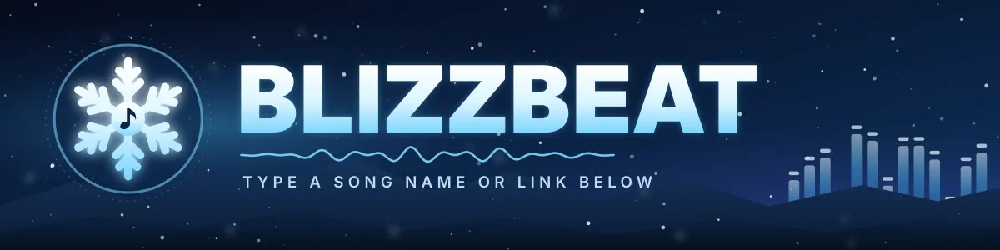

# Blizzbeat



A self-hosted Discord music bot with a dedicated player channel, in the spirit of the old music-request-channel bots. One Docker container runs both the bot and its own [Lavalink](https://github.com/lavalink-devs/Lavalink) audio server. You don't need to host anything else.

## What it does

- **Player channel.** `/setup create` makes a `#blizzbeat` channel with an animated banner at the top (falling snow, a bouncing equaliser and a light sweep across the logo) and a single player message under it. The player message is **edited in place**, never re-posted. It shows the song, artwork, a progress bar, who requested it, volume, loop mode and the upcoming queue.
- **Type to queue.** Anyone in a voice channel can type a song name or link in the Blizzbeat channel. The message is removed and the song is queued, so the channel stays clean.
- **❤️ Favourites.** Press ❤️ on the player to save the song that's playing (press it again to remove it). `/favourites play` queues them later, on any server that has Blizzbeat. Only you see the confirmation.
- **Drop a file to play it.** Drag an audio file (or a video, for its sound) into the Blizzbeat channel and it's queued like any other song. See [Playing your own files](#playing-your-own-files).
- **Buttons** on the player: ⏮️ previous, ⏯️ pause/resume, ⏭️ skip, ⏹️ stop, 🔉/🔊 volume, 🔀 shuffle, 🔁 loop, 📻 autoplay. Under them is an **audio effects** menu.
- **Autoplay.** When the queue runs out, Blizzbeat keeps going with related songs (YouTube's mix for the last song, then the same artist). Toggle it with 📻 or `/autoplay`.
- **Audio effects:** bass boost, nightcore, slowed, 8D, karaoke, soft and pop EQ.
- **Survives restarts.** The queue, current song, position, pause state, loop and effect are saved continuously. After an update, a crash or a reboot, Blizzbeat rejoins the voice channel and carries on where it left off.
- **Vote-skip.** Optionally, listeners vote to skip someone else's song instead of needing a DJ.
- **Live status.** The bot shows "Listening to …" and sets the voice channel's status line to the current song.
- **Cooldowns.** Admins set how often each person can request songs or press controls.
- **Slash commands** for everyone (`/play` with live search suggestions) and for admins (`/setup`, `/config`).
- **Sources:** YouTube, YouTube Music, Bandcamp, Twitch, Vimeo, Spotify (links and search once you add Spotify credentials), and **any link yt-dlp supports**: SoundCloud, Mixcloud, Audiomack, TikTok, X/Twitter, Reddit, Instagram, archive.org, direct audio files and [about 1,800 other sites](https://github.com/yt-dlp/yt-dlp/blob/master/supportedsites.md).
- Per-server settings are stored in SQLite and kept across restarts and updates.

## 1. Create the Discord bot

1. Go to <https://discord.com/developers/applications> and click **New Application**. Name it `Blizzbeat`.
2. Optional: under **General Information**, upload `assets/avatar.png` as the app icon.
3. Under **Bot**:
   - Click **Reset Token** and copy the token. It goes in `DISCORD_TOKEN`.
   - Under **Privileged Gateway Intents**, turn on **Message Content Intent**. Type-to-queue needs it.
   - Optional: upload `assets/avatar.png` as the bot avatar.
4. Start the container (next step). On startup the logs print an **invite link** with the right permissions. Open it to add Blizzbeat to your server.

## 2. Run it

```bash
git clone https://github.com/CtrlAltSpoods/Blizzbeat.git
cd Blizzbeat
cp .env.example .env      # then put your DISCORD_TOKEN in .env
docker compose up -d --build   # or: docker compose pull && docker compose up -d
docker compose logs -f    # watch it start; copy the invite link it prints
```

The first start takes a minute while Lavalink downloads its YouTube and Spotify plugins. They're cached in a volume after that.

### Prebuilt image

Every push to `main` is checked and then built by GitHub Actions into a multi-arch image (amd64 and arm64): `ghcr.io/ctrlaltspoods/blizzbeat:latest`. Each build is also tagged with its short commit SHA, so you can pin or roll back. `docker-compose.yml` points at this image. To update a running bot:

```bash
docker compose pull && docker compose up -d
```

The repo is private, so the image is too. Log in once on the server with a GitHub [personal access token](https://github.com/settings/tokens) that has the `read:packages` scope:

```bash
echo <TOKEN> | docker login ghcr.io -u <your-github-username> --password-stdin
```

### Unraid

**Docker** tab → **Add Container** (turn on **Advanced View**), then:

| Field | Value |
|---|---|
| Name | `blizzbeat` |
| Repository | `ghcr.io/ctrlaltspoods/blizzbeat:latest` |
| Network Type | `bridge` (no ports needed) |
| Extra Parameters | `--stop-timeout 20` |
| Path: `/data` | `/mnt/user/appdata/blizzbeat/data` |
| Path: `/opt/lavalink/plugins` | `/mnt/user/appdata/blizzbeat/plugins` |
| Variable: `DISCORD_TOKEN` | your bot token |
| Variable: `PUID` / `PGID` | `99` / `100` |

Add any other variables from `.env.example` the same way (**Add another Path, Port, Variable…** → Variable), for example `SPOTIFY_CLIENT_ID` and `SPOTIFY_CLIENT_SECRET`. To update, click the container icon → **Force update** (or turn on auto-update).

Running it without Compose:

```bash
docker build -t blizzbeat .
docker run -d --name blizzbeat --restart unless-stopped --stop-timeout 20 --env-file .env \
  -v blizzbeat-data:/data -v blizzbeat-plugins:/opt/lavalink/plugins blizzbeat
```

## 3. Set it up in your server

1. Run `/setup create` to make `#blizzbeat`, or use `/setup create channel:#your-channel` to use an existing channel.
2. Join a voice channel and type a song name in `#blizzbeat`, or use `/play`.

Blizzbeat needs these permissions in its channel: View Channel, Send Messages, Embed Links, Attach Files, Read Message History and **Manage Messages** (to clean up requests). It also needs Connect and Speak in voice channels, plus **Set Voice Channel Status** for the live status line. The invite link asks for all of them. If you invited Blizzbeat before that permission was added, give its role **Set Voice Channel Status** in Server Settings.

## Commands

### Everyone

| Command | What it does |
|---|---|
| `/play song:<name or URL> [next]` | Play or queue a song, playlist or album. Suggestions appear as you type. `next:true` puts it at the front of the queue. |
| `/pause` `/resume` | Pause or resume |
| `/skip [count]` | Skip one or more songs. With vote-skip on, it adds your vote instead. |
| `/previous` | Play the previous song again |
| `/stop` | Stop and clear the queue (stays in the voice channel) |
| `/queue [page]` | Show the queue |
| `/nowplaying` | Show the current song |
| `/volume [level]` | Show or set the volume |
| `/seek time:<1:30>` | Jump to a time in the song |
| `/loop [off/song/queue]` | Set the loop mode, or cycle through modes if left empty |
| `/shuffle` `/clear` | Shuffle or clear the queue |
| `/remove position` `/move from to` | Edit the queue |
| `/leave` | Disconnect from voice |
| `/autoplay [enabled]` | Turn autoplay on or off (toggles if left empty) |
| `/effect name` | Bass boost, nightcore, slowed, 8D, karaoke, soft, pop EQ or off |
| `/favourites play [song] [shuffle] [next]` | Queue all your ❤️ favourites, or one of them |
| `/favourites list [page]` `/favourites remove song` `/favourites clear` | See or tidy your favourites (only you see these) |
| `/help` | Quick guide |

Commands used inside the Blizzbeat channel reply privately so the channel stays clean.

### Admins (Manage Server)

| Command | What it does |
|---|---|
| `/setup create [channel]` | Create or choose the player channel and post the banner and player |
| `/setup refresh` | Re-post the banner and player at the bottom of the channel |
| `/setup remove` | Remove the player (the channel itself is kept) |
| `/config view` | Show all settings |
| `/config default-volume` | Volume Blizzbeat starts at when it joins |
| `/config max-volume` | Highest volume anyone can set |
| `/config voice-channels allow/disallow/list/clear` | Limit which voice channels Blizzbeat can join |
| `/config dj-role [role]` | Only this role can control playback. Everyone can still request songs and skip their own, and anyone alone with the bot counts as DJ. |
| `/config request-role [role]` | Only this role can add songs |
| `/config queue-limit` | Maximum number of songs in the queue |
| `/config user-limit` | Maximum queued songs per person |
| `/config song-length` | Longest song allowed, in minutes |
| `/config playlists` | Allow or block playlists and albums |
| `/config uploads` | Allow or block audio files dropped in the player channel, and set the largest file size (default 100 MB) |
| `/config auto-leave` | Minutes to wait before leaving when idle or alone |
| `/config stay-247` | Stay in voice 24/7 |
| `/config vote-skip enabled [percent]` | Listeners vote to skip other people's songs (default 50% of the channel). Admins, DJs, the requester and anyone alone with the bot skip instantly. |
| `/config cooldowns [requests] [controls]` | Seconds each person must wait between song requests and between controls (0 = off, admins exempt). Run it with no options to see the current values. |
| `/config youtube` | Sign in to YouTube with a spare Google account (fixes "confirm you're not a bot"), check status, sign out, or switch YouTube between the Lavalink plugin and yt-dlp |
| `/config buffer [seconds]` | Audio buffer for all servers (default 1 s, 0.2–30). Bigger rides out network hiccups; smaller reacts faster. Lavalink restarts once nothing is playing. |
| `/config voice-status` | Show the current song as the voice channel's status |
| `/config search-source` | Where typed song names are searched: YouTube Music, YouTube, SoundCloud or Spotify |
| `/config banner [image]` | Upload a custom banner (PNG, JPG, or animated GIF/WebP), or leave empty to restore the default. The banner message is edited, not re-posted. |
| `/config color` | Accent colour of the player embed |
| `/config blocklist add/remove/list` | Block people from using Blizzbeat |
| `/config reset` | Reset every setting to its default (keeps the channel) |

Server owners can also change who sees these commands under **Server Settings → Integrations → Blizzbeat**.

## Audio quality

Blizzbeat plays YouTube's Opus audio (about 130–160 kbps) straight through to Discord, with no re-encoding, as long as:
- the volume is **100%** (the default), and
- no effect is selected.

Blizzbeat also tries to get you the best recording:
- **YouTube's best stream.** The YouTube plugin picks the best audio format YouTube offers: Opus, without dynamic-range compression, at the highest bitrate.
- **Official audio over music videos.** Typed searches use YouTube Music by default, Spotify links are matched on YouTube Music first, and autoplay swaps music videos for their official audio uploads when the length matches. That means no video intros or outros, and the studio master.
- **An adjustable audio buffer** (1 second by default). `/config buffer` changes it for all servers: raise it if songs stutter or say "track stuck" on a slow connection; keep it low so volume, effects and skips react quickly.

At any other volume, or with an effect on, Lavalink has to decode and re-encode the audio, which loses some quality. The player shows **🎧 original** next to the volume when you're getting the untouched stream. To make it quieter without losing quality, use Discord's own slider: right-click Blizzbeat → **User Volume**.

## Links from other sites (yt-dlp)

YouTube, Spotify, Bandcamp, Twitch and Vimeo links play through Lavalink's own sources. **Any other link** is handed to yt-dlp, which supports [about 1,800 sites](https://github.com/yt-dlp/yt-dlp/blob/master/supportedsites.md), SoundCloud included. Here's what happens:
1. yt-dlp reads the title, artist, length, artwork and playlist entries.
2. When the song plays, ffmpeg converts its audio to Opus at 256 kbps (`MEDIA_OPUS_BITRATE`). Audio that is already Opus (YouTube, some SoundCloud tracks) is passed through untouched instead.
3. Lavalink plays that from a small server inside the container. It only listens on 127.0.0.1 and only serves links the bot signed itself.

For safety, links that point to private network addresses (your LAN, the container itself) are refused. Songs from these sites can't be seeked, and if yt-dlp can't read a SoundCloud link, Blizzbeat plays the same song from YouTube instead.

## Playing your own files

Join a voice channel and drop an audio file into `#blizzbeat` (up to 10 files in one message). Blizzbeat shows ⏳ while it copies the file, then removes the message and queues the song. Any text you type with the file is ignored.

- **Formats:** MP3, FLAC, WAV, OGG/Opus, M4A/AAC, ALAC, AIFF, WMA and most others ffmpeg can read, plus the sound from video files (MP4, MKV, WebM, MOV and so on).
- **Quality:** MP3, FLAC, 16-bit WAV, Ogg (Opus/Vorbis) and M4A (AAC) files are played exactly as uploaded. Audio from videos is copied out without re-encoding where possible. Other formats (ALAC, AIFF, 24-bit WAV and so on) are converted to FLAC, which loses nothing. Uploaded songs show their real length and can be seeked.
- **Title:** taken from the file's tags (title and artist), or from the file name if it has none.
- **Size:** Discord's own upload limit applies (10 MB per file without Nitro or a boosted server). Admins can set a lower or higher cap with `/config uploads`, up to 500 MB.
- **Storage:** Discord deletes a file when its message is deleted, so Blizzbeat keeps a copy in `/data/uploads`. A copy is deleted once the song is no longer queued, playing or in the player's history, including after a restart. Nothing stays there long term.
- The same rules as other requests apply: request role, blocklist, cooldown, song length, queue and per-user limits.
- Needs the **Message Content** intent (the same switch that type-to-queue uses).

## Staying up to date

Blizzbeat keeps itself current in three layers:

1. **Inside the container (on launch and daily).** It checks GitHub for newer releases of **Lavalink**, the **YouTube plugin** and **LavaSrc**:
   - It only upgrades, never downgrades, and only within Lavalink 4.x.
   - Updates are applied by restarting Lavalink **while nothing is playing**.
   - If an updated version doesn't load, it's rolled back automatically and that version is skipped from then on.
   - Every step is logged with the `[updater]` prefix, and `/config view` shows the versions running. Set `AUTO_UPDATE=false` to turn this off. A version you set yourself (e.g. `LAVASRC_VERSION`) is never changed.
2. **On GitHub (weekly).** The **Update dependencies** workflow bumps those versions plus yt-cipher, runs the smoke test against them, commits the change if it passes, and rebuilds the image. The weekly rebuild also picks up Node package updates and base-image security fixes.
3. **On your server.** Pull new images automatically. On Unraid, install **CA Auto Update Applications** from the Apps tab, then go to **Settings → Auto Update Applications → Docker** and turn on auto-update for `blizzbeat` (daily is fine). With Docker Compose, a scheduled `docker compose pull && docker compose up -d` or [Watchtower](https://containrrr.dev/watchtower/) does the same.

The bot code itself, yt-cipher, Node and Java only change through new images (layers 2 and 3). A container can't replace its own image safely.

## Configuration (`.env`)

Everything is documented in [`.env.example`](.env.example). The main settings are:

| Variable | Default | Notes |
|---|---|---|
| `DISCORD_TOKEN` | — | **Required** |
| `DEV_GUILD_ID` | — | Register commands to one server instantly while testing |
| `ENABLE_MESSAGE_CONTENT` | `true` | Set to `false` if you can't enable the Message Content intent. `/play` still works. |
| `SPOTIFY_CLIENT_ID` / `SPOTIFY_CLIENT_SECRET` | — | Turns on Spotify links and search |
| `YOUTUBE_PLUGIN_VERSION` | tested build | Leave empty for the default (a youtube-source build with the TV client fix). Set a newer release when one ships. |
| `YOUTUBE_BACKEND` | `plugin` | `plugin` or `ytdlp` (also switchable with `/config youtube`) |
| `YOUTUBE_BUILTIN_CIPHER` | `true` | Runs yt-cipher inside the container to decode YouTube stream signatures |
| `DEFAULT_VOLUME`, `MAX_VOLUME`, `DEFAULT_MAX_QUEUE`, `DEFAULT_AUTO_LEAVE_MINUTES`, `DEFAULT_SEARCH_SOURCE` | | Starting values for new servers |
| `PROGRESS_UPDATE_SECONDS` | `10` | How often the progress bar refreshes |
| `DEFAULT_REQUEST_COOLDOWN`, `DEFAULT_CONTROL_COOLDOWN` | `3`, `0` | Starting cooldowns in seconds |
| `LAVALINK_FRAME_BUFFER_MS` | `1000` | Starting audio buffer (overridden by `/config buffer`) |
| `ANIMATED_BANNER` | `true` | Use the animated default banner; `false` for the still one |
| `MEDIA_OPUS_BITRATE` | `256k` | Opus bitrate for songs from yt-dlp sites that aren't Opus already (Opus audio is passed through untouched) |
| `AUTO_UPDATE` | `true` | In-container updates of Lavalink and its plugins (see *Staying up to date*) |
| `RESTORE_MAX_AGE_MINUTES` | `60` | Don't resume queues saved longer ago than this (24/7 servers always resume) |
| `JAVA_OPTS` | `-Xms128m -Xmx512m` | Memory for the built-in Lavalink |

## When songs won't play

**"Sign in to confirm you're not a bot" / "This video requires login".** YouTube blocks a lot of servers, and every Lavalink bot hits this. The fix takes a minute and only needs doing once:

1. In Discord, run `/config youtube` and pick **Sign in**.
2. Blizzbeat replies (only you see it) with a link and a code. Open the link on any device, enter the code, and choose a **spare Google account**, not your main one.
3. The reply changes to ✅ when it's done. The sign-in is saved in `/data` and re-applied after every restart. `/config youtube` → **Status** shows whether it's active.

When a song is blocked, Blizzbeat also posts a reminder about this in its channel.

**"TVHTML5: The page needs to be reloaded".** This is a youtube-source bug ([#226](https://github.com/lavalink-devs/youtube-source/issues/226)) that's fixed but not in a release yet. Blizzbeat uses a fixed development build by default. Leave `YOUTUBE_PLUGIN_VERSION` empty, or remove it if you set it.

**Trying yt-dlp instead.** Blizzbeat can play YouTube through [yt-dlp](https://github.com/yt-dlp/yt-dlp) instead of Lavalink's YouTube plugin. Switch with `/config youtube` → **Play YouTube through yt-dlp** (or set `YOUTUBE_BACKEND=ytdlp`), and switch back the same way. Lavalink restarts for about 20 seconds once nothing is playing. What changes:
- yt-dlp is updated very often, and Blizzbeat downloads each new release automatically (launch + daily).
- Searches use plain YouTube (yt-dlp can't search YouTube Music), and each search and song start takes a second or two longer.
- Songs play through Blizzbeat's media server, which fetches the audio the way yt-dlp does (Lavalink fetching YouTube's stream itself gets "403"). YouTube's Opus audio is passed through untouched, but these songs can't be seeked.
- If the last few songs all fail, autoplay stops instead of trying song after song.
- YouTube's bot check applies to yt-dlp too. Its fix is a cookies file instead of `/config youtube` sign-in:
  1. In a **private/incognito** window, sign in to YouTube with a **spare** Google account.
  2. Export the youtube.com cookies in Netscape format (for example with the "Get cookies.txt LOCALLY" extension), then close the window without signing out.
  3. Save the file as `youtube-cookies.txt` in the data folder (Unraid: `/mnt/user/appdata/blizzbeat/data/`). It's used from the next song on.

**Other YouTube errors.** Blizzbeat runs [yt-cipher](https://github.com/kikkia/yt-cipher) inside the container to decode YouTube's stream signatures, which fixes "Must find sig function". If YouTube changes again, set `YOUTUBE_PLUGIN_VERSION` to the newest release from <https://github.com/lavalink-devs/youtube-source/releases> and restart. Lavalink downloads it automatically.

**SoundCloud.** SoundCloud changed its streaming format in November 2026, and Lavalink can't play the new one yet ([lavaplayer #204](https://github.com/lavalink-devs/lavaplayer/issues/204)). SoundCloud **links** play through yt-dlp instead (see below). SoundCloud **searches** still go through Lavalink, so they fall back to YouTube Music until that's fixed upstream.

**"The application did not respond" / "Unknown interaction".** Discord gives a bot 3 seconds to acknowledge a command. On startup Blizzbeat logs a `Network check:` line with DNS time, Discord round-trip time and your server's clock offset, and warns if any of them could cause this. Common fixes on Unraid:
- Turn on NTP: **Settings → Date and Time → Use NTP server: Yes**.
- Set the container's DNS: add `--dns 1.1.1.1` to **Extra Parameters**.

**Health check.** The **Smoke test** workflow in GitHub Actions runs the real image against a real Lavalink after every push, and prints a PASS/WARN/FAIL report. YouTube blocks GitHub's servers, so YouTube playback shows as WARN there even when it works on your own connection.

## How it's built

```
Docker container (tini as PID 1)
├── Lavalink 4.2 (Java 17), only listening on 127.0.0.1:2333
│   └── plugins: youtube-source, LavaSrc (Spotify)
├── yt-cipher (Deno, compiled), 127.0.0.1:8001, decodes YouTube stream signatures
├── yt-dlp + Deno, used by LavaSrc when YOUTUBE_BACKEND=ytdlp (docker/yt-dlp.sh adds cookies)
└── Blizzbeat (Node 22, discord.js v14, lavalink-client)
    ├── src/controller.js   banner + player message, edited in place with debounced, rate-limited updates
    ├── src/music.js        requests, limits, permissions, controls, auto-leave
    ├── src/commands/       slash command definitions and handlers
    ├── src/events.js       Lavalink/Discord events, type-to-queue and dropped files
    ├── src/media.js        yt-dlp links and uploaded files, served to Lavalink on 127.0.0.1
    ├── src/uploads.js      copies, checks and cleans up dropped audio files
    ├── src/persistence.js  saves player sessions and restores them on boot
    ├── src/status.js       "Listening to" presence and voice channel status
    └── src/db.js           settings + sessions (node:sqlite at /data/blizzbeat.sqlite)
```

`docker/entrypoint.sh` writes Lavalink's `application.yml` from your environment variables, starts Lavalink, waits for it to be ready, and then starts the bot. If either process dies, the container exits and Docker restarts it. On `docker compose down` or a restart, the bot is stopped first so it can save every queue and leave voice before Lavalink shuts down. The health check confirms that Lavalink responds and that the bot has a live Discord connection.

The banner and avatar are generated by `assets/src/make_banner.py`, and the animated banner (`assets/banner.webp`) by `assets/src/make_banner_anim.py`. Edit the scripts and re-render to change the default artwork. Set `ANIMATED_BANNER=false` to use the still `banner.png` instead. The bot's Discord profile banner (`assets/profile-banner.png`, animated `profile-banner.gif`) comes from `assets/src/make_profile_banner.py`; upload it in the Developer Portal under **Bot → Banner**. The animated avatar (`assets/avatar.gif`) comes from `assets/src/make_avatar_anim.py` and goes under **Bot → Icon**.

### Local development (without Docker)

You need Node 22.13 or newer and a Lavalink 4 server you can reach.

```bash
npm install
DISCORD_TOKEN=... LAVALINK_HOST=localhost LAVALINK_PASSWORD=youshallnotpass DATA_DIR=./data npm start
```
